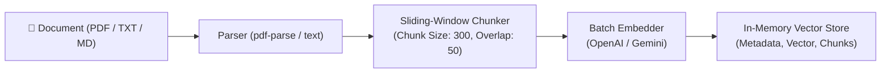
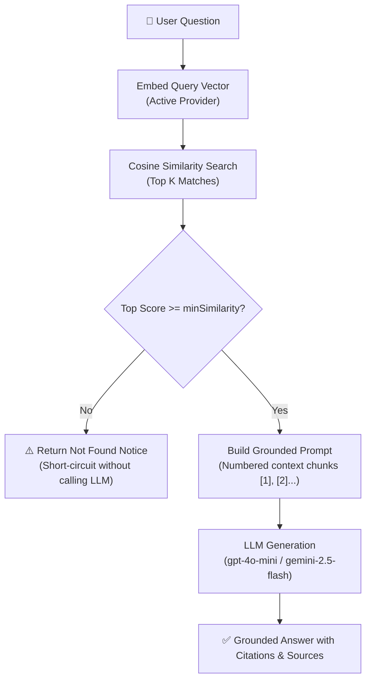

# ⚡ RAG Generator

A lightweight, end-to-end Retrieval-Augmented Generation (RAG) system with a Node.js/Express backend, an in-memory vector store, support for multiple LLM & embedding providers (OpenAI and Google Gemini), and a modular React frontend with cited source inspection.

---

## 🚀 Quick Setup

### 1. Prerequisites
- **Node.js**: v18+ (Node 20+ recommended)
- **npm**: v9+
- API Key for **OpenAI** and/or **Google Gemini**

### 2. Install Dependencies
```bash
# Install backend dependencies
cd backend && npm install

# Install frontend dependencies
cd ../frontend && npm install
cd ..
```

### 3. Configure Environment Variables
Copy `.env.example` to `.env` in the project root:
```bash
cp .env.example .env
```
Fill in your API keys and configuration in `.env`.

### 4. Start the Application
You can run both backend and frontend using the provided helper script:
```bash
chmod +x dev.sh
./dev.sh
```
Or start them individually:
* **Backend**: `cd backend && npm run dev` (Runs on `http://localhost:5001`)
* **Frontend**: `cd frontend && npm run dev` (Runs on `http://localhost:5173`)

---

## 🌐 Deploying on Vercel

This repository is pre-configured with [`vercel.json`](./vercel.json) and [`api/index.js`](./api/index.js) for one-click deployment on Vercel.

### Steps to Deploy:
1. Push your repository to GitHub.
2. Go to [Vercel Dashboard](https://vercel.com/new) and import `rag-generator`.
3. In the project **Environment Variables** settings on Vercel, add:
   * `OPENAI_API_KEY` (and/or `GEMINI_API_KEY`)
   * `EMBEDDING_PROVIDER` (e.g., `openai`)
   * `CHAT_PROVIDER` (e.g., `openai`)
   * `OPENAI_MIN_SIMILARITY` (e.g., `0.5`)
4. Click **Deploy**. Vercel will automatically build the Vite React frontend and route `/api/*` to the serverless backend function.

---

## ⚙️ Choosing Providers in `.env`

You can independently select providers for embeddings and chat generation:

```env
# Provider Selection ('openai' | 'gemini')
EMBEDDING_PROVIDER=openai
CHAT_PROVIDER=openai

# API Keys
OPENAI_API_KEY=sk-proj-your-openai-key-here
GEMINI_API_KEY=AIzaSy-your-gemini-key-here

# Models
OPENAI_EMBEDDING_MODEL=text-embedding-3-small
OPENAI_CHAT_MODEL=gpt-4o-mini

GEMINI_EMBEDDING_MODEL=text-embedding-004
GEMINI_CHAT_MODEL=gemini-2.5-flash

# Chunking & Retrieval Parameters
CHUNK_SIZE=300
CHUNK_OVERLAP=50
EMBEDDING_BATCH_SIZE=50
TOP_K=4
OPENAI_MIN_SIMILARITY=0.5
GEMINI_MIN_SIMILARITY=0.5
```

> **Key Formatting Tip:**
> - **OpenAI keys** begin with `sk-` or `sk-proj-...`
> - **Gemini keys** (from Google AI Studio) begin with `AIzaSy...`

---

## 📊 Pipeline Diagrams

### 1. Ingestion Pipeline


### 2. Query & Retrieval Pipeline


---

## 🧠 Design Decisions

1. **In-Memory Vector Store with Cosine Similarity**:
   - Zero external database dependencies (e.g., Pinecone/Milvus/pgvector) for quick local development and testing.
   - Exact cosine similarity calculation with validation to prevent dimension mismatches across providers.
2. **Strict Grounding & Anti-Hallucination**:
   - Prompts enforce answers using *only* facts present in retrieved chunks.
   - If the top vector similarity score falls below `minSimilarity`, the query short-circuits with a clear score report instead of hallucinating.
3. **Modular Provider Abstraction**:
   - Clean adapters for OpenAI and Google Gemini with automatic exponential backoff retry mechanisms.
4. **Modular React Component Hierarchy**:
   - Separated sidebar, upload card, collection manager, message feed, and interactive source cards for maintainability.

---

## ⚠️ Known Limitations

- **In-Memory Persistence**: Vector collections are stored in memory and reset when the backend server restarts.
- **Broad Meta-Questions**: Asking broad questions like *"What is this document about?"* without document-specific keywords may yield low cosine similarity against fine-grained paragraph chunks. Lower `OPENAI_MIN_SIMILARITY` in `.env` (e.g., to `0.15`–`0.2`) or ask targeted questions.
- **Complex Tabular Parsing**: PDFs containing complex multi-column data grids are parsed as linear text, which can reduce retrieval accuracy for cell-by-cell queries.

---

## 🧪 Sample Questions to Try

Using the included sample documents in `sample-docs/`:

1. **Architecture & Technical Docs**:
   - *"What are the core design principles of the API architecture?"*
   - *"Explain the branching and release workflow."*
2. **Specific Data & Section Inquiries**:
   - *"What renewable energy capacity statistics are listed for North America?"*
   - *"What indicators are tracked in the report?"*
3. **Out-of-Scope / Fallback Test**:
   - *"What is the recipe for chocolate chip cookies?"* (Verifies that the model outputs a grounded refusal rather than hallucinating).
